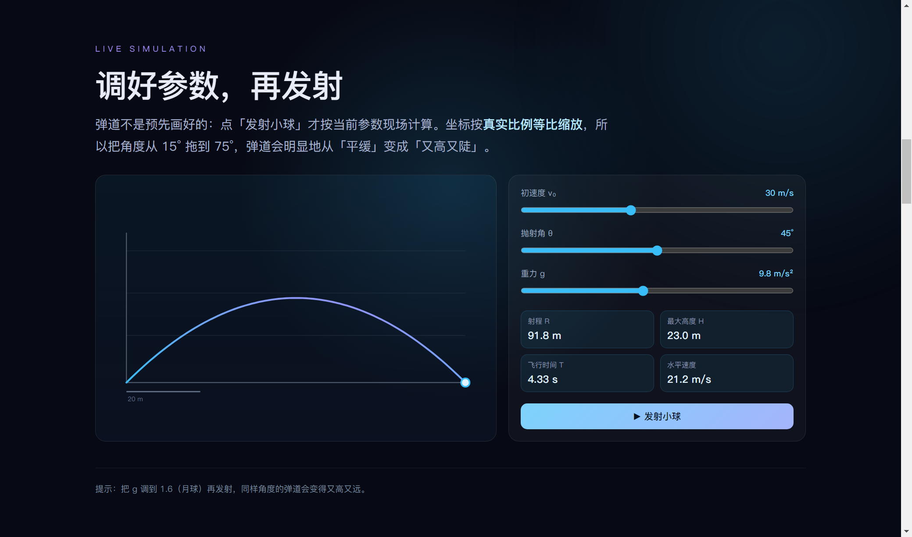
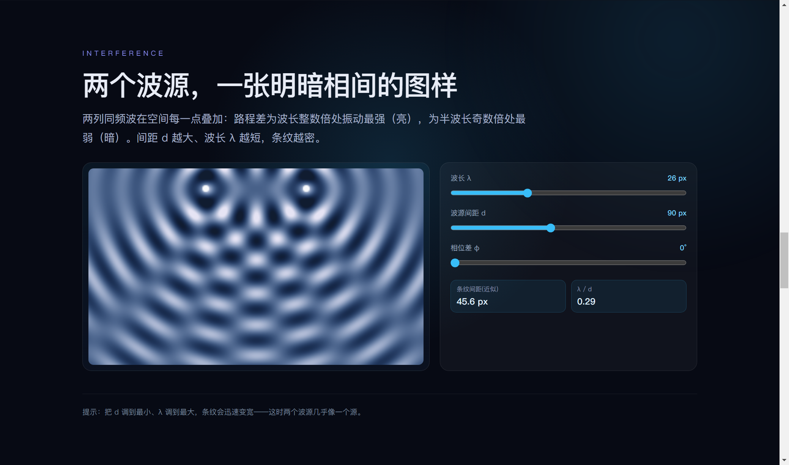
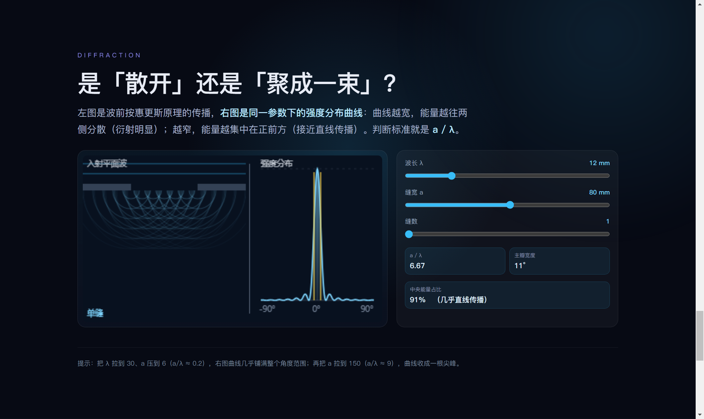

# Lumina · AI HTML 幻灯片播放器

> ### 🤖 本项目的实现方式
>
> **本项目的全部内容 —— 代码、文档、图标、示例幻灯片与自动化测试 —— 均由 AI 编程 Agent「DeepSeek Harness」自主完成。**
> 仓库所有者只承担**下达指令**的角色：提出需求、试用并反馈问题、在需要账号授权时完成登录操作。
>
> 具体而言，以下均由 Agent 完成：整体架构与全部源码、176 项自动化断言、四套可交互示例（物理 / 数学 / 商务 / 使用指引）、应用图标绘制、NSIS 打包配置、Git 提交信息，以及这份 README 本身。

把 AI 写的 HTML 幻灯片**直接播放**，并补齐演示必备的编辑、演讲者模式、画笔/荧光笔/激光笔标注能力。

支持两种主流 AI HTML 形态：
- **Reveal.js**（`<section>` 分页，最常见）
- 普通 `.slide` / `.page` / `.frame` / `.screen` / 全屏 `<section>` / scroll-snap 分页

内置几份**能动手的**教学示例（物理 / 数学 / 商务），第一次打开会让你选领域：







---

## 功能一览

| 功能 | 说明 |
|---|---|
| ▶ 直接播放 | 拖入/打开 HTML 自动识别每一页；方向键、滚轮、**单击**、按钮、触摸滑动翻页，全屏 |
| ➕ 从零新建 | 还没导入/生成任何东西时也能开始：欢迎页「**新建空白演示**」，编辑模式左侧「新增一页」在无文档时也会自动建一份再插页 |
| 🧲 智能参考线 | 拖动时自动吸附到**页面边缘/中心**与**同级元素**的边与中心，并显示红色参考线；按住 `Alt` 临时关闭吸附 |
| ✏️ 元素级编辑 | **对标 PPT 的完整编辑**：单击选中 / Shift·Ctrl 加选 / 全选；拖动移动、八向手柄缩放、**旋转、透明度、圆角、边框、阴影、内边距、渐变填充**；**6 向对齐 + 等距分布**；层级（置顶/置底/上移/下移）；**字体/字号/行高/字距/加粗/斜体/下划线/文字阴影/**文字色/背景色；双击改文字；Ctrl+A/C/V/D；方向键微调。**右侧属性面板**精确设置 X/Y/宽/高；增删复制页、拖拽排序、换背景、加文本框/图片，保存回 HTML |
| 🎯 分类型的菜单 | 像 PPT 一样**按元素类型给出不同编辑项**：面板顶部显示元素类型（文本 / 形状·容器 / 图片·媒体 / 矢量图形 / 列表），只显示该类型真正能改的项——文本才出现字体行高、图片才出现适应方式与滤镜、形状才出现渐变填充与内边距；工具条同样按类型裁剪 |
| 🎛 复杂动效也能编辑 | 编辑模式会自动**暂停入场动画并把元素推到结束态**（不会看不见、选不中），拖动时自动**固化 transform**（旋转/缩放过的元素也不跳位）；渐变背景改底色、渐变文字改颜色都会真正生效；还可**一键替换图片**（本地文件转内联） |
| 🧭 首次启动引导 | 第一次打开会让你**选择领域**（物理教学 / 数学教学 / 商务数据 / 了解软件），随后自动载入对应演示——它本身就是使用指引 |
| 🎬 多套内置示例 | `sample/physics.html` 抛体运动（**拖滑块实时重算轨迹**）、`sample/math.html` 函数图像（**调参实时重绘**）、`sample/business.html` 商务数据看板（**切换维度图表重绘**）、`sample/tour.html` 软件使用指引 |
| ✨ 动效 | 示例自带「只有 HTML 能做到」的动效：滚动驱动入场、逐字浮现、SVG 矢量绘制、鼠标跟随光晕、实时数字增长、卡片 3D 倾斜；**切到编辑模式会自动暂停动效**，保证任何元素都可见可选中 |
| 🎤 演讲者模式 | **对齐 PPT 演示者视图**：你的屏幕是控制台——当前页大预览、右下**备注大字（字号可调）**、右上下一页、顶部页码+标题+**计时器（可暂停/归零）**、底部缩略图条与标注工具；投影窗口只放正片（鼠标移入才出迷你条）。支持**黑屏/白屏**（`B`/`W`）把注意力拉回讲者；`←` `→` `空格` 翻页、`Esc` 结束，两窗口双向同步 |
| 🖍 标注工具 | 画笔、荧光笔、激光笔、橡皮、撤销、清空；**画笔/橡皮带落笔光点**，笔迹在控制台/投影间同步 |
| 🤖 AI 助手 | **内置 AI 调用**：三种模式（生成新演示 / 改这一页 / 改整个演示），可上传真实数据、图片、文字；**多模型管理**——API Key 只填一次，之后下拉切换 |
| 📺 全屏浮动工具栏 | 全屏时控制条悬浮半透明，可手动收起，无操作自动隐藏，鼠标移到底部唤出 |

## 快捷键

- `→` / `↓` / `空格` / `PageDown`：下一页；`←` / `↑` / `PageUp`：上一页
- 单击：下一页（遇到链接/按钮等交互元素自动不翻，可关闭）；滚轮：翻页
- `Home` / `End`：第一页 / 最后一页；`Esc`：退出全屏 / 取消选中
- 编辑模式：单击选中元素，双击改文字，拖动移动，`Delete` 删除选中元素
- `Ctrl+B` / `Ctrl+I`：编辑文字时加粗/斜体

## 如何运行

### 方式一：Windows 安装包（推荐）
到 [**Releases**](https://github.com/R09OR0RBSVBFTkc/lumina/releases/latest) 下载 `Lumina Setup 1.0.0.exe` 安装即可。（安装包 75 MB，走 Release 分发，不进仓库。）

### 方式二：源码运行
```bash
npm install   # 或 pnpm install
npm start     # 启动桌面版
npm run dist  # 打包 Windows 安装程序（产物在 release/）
```

### 方式三：浏览器 / 手机（PWA，多端）
1. 项目目录起本地服务：`python -m http.server 8000`
2. 浏览器打开 `http://localhost:8000`
3. 桌面 Chrome/Edge 点地址栏「安装」装成应用；安卓 Chrome / iPhone Safari「添加到主屏幕」当 App 用。
   > 演讲者模式需要两个窗口，建议在电脑上用；手机可正常播放与标注。

## 使用步骤

1. 点「📂 打开 HTML」选择 AI 生成的幻灯片，或点「✨ 示例」体验。
2. **播放模式**：单击/方向键/滚轮翻页；底部工具栏选画笔/荧光笔/激光笔在画面上标注。
3. 点「✏️ 编辑」进入编辑模式：**单击任意元素选中，拖动移动、Delete 删除，工具条改样式，双击改文字**；左侧栏管理页面。
4. 点「🎤 演讲者模式」：自动弹出正片窗口（有第二屏自动放第二屏），本窗口变成控制台。
5. 改完点「💾 保存」导出 HTML；「🖨 导出 PDF」走浏览器打印另存为 PDF。

## 关于 AI 与兼容性

AI 生成的 HTML 五花八门，本软件已兼容主流分页格式并自动兜底。**推荐直接用工具栏「🤖 AI 助手」**：

1. 点「添加」，选一个服务商（DeepSeek / OpenAI / Kimi / 通义千问 / 智谱 GLM / 自定义），**粘贴 API Key 即可** —— 接口地址自动确定，模型自动带出（也可点「获取」从服务端拉取完整列表，或手填）；
2. 保存后，**这份配置就记住了，以后打开面板只需在下拉里选模型**，不必再填任何东西；
3. 描述你的需求（**风格完全按你的描述来，软件不预设风格**）、上传真实数据 / 图片 / 文字，AI 会按规范格式（每页 `<section class="slide">`、备注写在 `data-notes`、页面铺满屏幕、自包含资源）产出可完美播放的幻灯片；
4. 也可以对当前幻灯片下达修改指令，AI 知道自己在改第几页，直接改好，全程无需复制粘贴。

## 目录结构

```
html-slides-player/
├─ index.html            主界面
├─ css/app.css           样式
├─ js/                   逻辑（sync 同步 / player 播放 / annotate 标注 / editor 元素编辑 / presenter 演讲 / ai AI 助手 / main 主控）
├─ sample/               示例幻灯片
├─ icons/                图标
├─ electron/             桌面封装（main 主进程 / preload 预加载）
├─ tools/                开发工具与自动化测试
├─ manifest.webmanifest   PWA 清单
├─ sw.js                 Service Worker（离线缓存）
└─ package.json           Electron 构建配置
```

## 说明与限制

- 建议 AI 生成的幻灯片使用**内联 CSS / base64 图片 / CDN 资源**（绝大多数如此），相对路径的本地图片在浏览器里可能无法解析。
- 标注笔迹以「归一化坐标」存储，正片与控制台预览按相同比例映射；投影建议 16:9。
- 编辑是对已加载页面实时修改，`保存` 会导出为完整 HTML 文件。

## 参与贡献

欢迎提 Issue 和 PR：见 [CONTRIBUTING.md](CONTRIBUTING.md)（含运行方式、测试方法、代码结构）。
项目没有构建步骤——改完 `js/` 或 `css/` 直接刷新即可；改完请跑一遍 `npx electron tools/full-test.js`（当前 **176/176** 通过）。

## 开源许可

[MIT License](LICENSE) © 2026 Lumina contributors

---

本仓库的所有代码、文档与资源均由 AI 编程 Agent **DeepSeek Harness** 生成，仓库所有者仅提出需求并验收。

